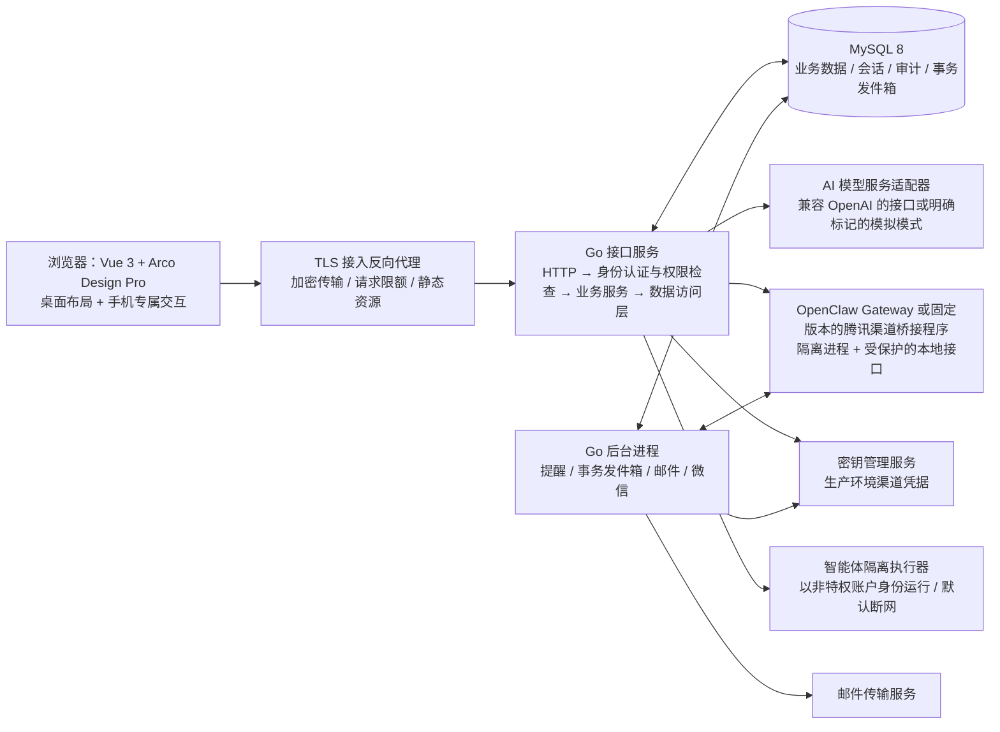

# TeamMind 架构与实施交接规格

**用途**：把当前仓库交给新的工程负责人后，作为实现基线、边界说明和验收合同。本文分别标记“代码已实现”“本地自动化已验收”和“仍须外部验证”；本地测试通过不代表真实第三方服务或生产主机验收通过。

**术语约定**：正文说明均使用中文。为保证实现与验证时名称准确，产品名、标准名、接口路径、代码标识、数据库表名、环境变量和状态枚举保留原文，并在需要时附中文解释。

**当前基线**（2026-10-19）：前端使用 Arco Design Pro Vue Vite 2.7.3，后端使用 Go HTTP 接口和 MySQL 8；业务接口前缀为 `/api/v1`。数据库最新迁移为 `000021_membership_versions`。必须保留官方模板许可文件 `LICENSE.arco-design-pro-vue`。现有可复核资料：[`README.md`](../README.md)、[逐控件审计](FUNCTION_AUDIT.md)、[验收证据与缺口](ACCEPTANCE.md)、[交付报告](DELIVERY_REPORT.md)。

## 1. 当前状态摘要

### 已存在的产品闭环

- 使用 bcrypt 密码哈希的账号系统，支持注册、登录、退出、密码重置、会话续期和撤销；首位平台超管通过 `bootstrap-admin` 命令初始化。
- 多团队成员关系与服务端角色检查；团队、成员、邀请、项目、任务、依赖、评论、协作者、计划提案与审批、审计均持久化到 MySQL。
- 个人对话/记忆与团队知识分离；模型服务具有明确标记的模拟模式；智能体可由已配置的真实模型从服务端白名单选择任务/项目读取、待审批任务/项目/成员提案、逐次授权的团队知识候选，以及断网 Python/Bash 沙箱；私人文本工作区以 AES-GCM 加密持久化并由本人逐次授权访问。无审批正式业务写入和无界宿主机命令不开放。
- 站内通知、邮件、浏览器 Web Push、原生 FCM 推送、免打扰、MySQL 幂等投递队列/重试记录和定时提醒后台进程；通知渠道配置缺失时页面如实显示不可用。
- 固定 OpenClaw 2026.10.4 与腾讯 `@tencent-weixin/openclaw-weixin@2.4.10` Gateway 集成：TeamMind Go API 通过认证的 loopback 桥接发起真实 QR、读取等待状态、取消；Go worker 只规范化插件 API 适配器返回的消息并调用插件发送 API，不自行实现微信网络协议。真人扫码、手机确认、1 个有效绑定、1 条真实入站记录和 API/Gateway/worker 重启后的绑定读回已在隔离环境验证。修复测试夹具清理问题后，早前统计的多余 `Worker Test` 数据已删除。完整生产模型回复仍未通过：当前 AI 为 `mock`，唯一真实投递记录失败，模拟回复不会发往微信。OpenClaw 2026.10.4 要求 Node.js ≥24.16 且 <25，或 ≥26.1。
- 登录按钮故障已修复，并用浏览器检查默认、鼠标悬停、键盘焦点、按下/加载、失败/成功、鼠标点击中心/边缘、键盘操作和触摸；设置与通知页通过指定视口专项验收。
- 设置页提供本人数据 JSON 导出、逐条删除私人对话和账号注销。账号注销要求当前密码与确认文字；启用 MFA 时强制第二因素；禁止注销团队所有者或唯一平台超管。私人数据即时清除，团队业务记录保留并匿名化署名。API 后台每小时按 30/90/180/365/2555 天规则分批清理过期认证材料、历史提醒、微信载荷、通知和本地审计；部署方仍需确认法律留存期限并配置不可变外部审计归档。
- 迁移 `000012_auth_ip_rate_limits` 增加登录/注册/找回/重置来源限流和超管脱敏告警；IP 仅以 HMAC 键保存。生产 HMAC 密钥、可信反向代理配置和外部值班告警渠道仍需部署验证。

### 已实现能力的外部验收限制

1. 邮件通知和移动浏览器 Web Push 的适配器、持久队列与重试已实现并通过本地测试；当前环境 SMTP 未配置；`VAPID_SUBJECT` 是保留 `.invalid` 域名，服务端现将推送报告为未配置且不返回公钥。没有活动浏览器订阅，真实邮件与网页推送送达尚未验证。
2. 智能体白名单工具选择、待审批任务/项目变更提案、管理员逐次授权的待确认团队知识候选、断网 Python/Bash 沙箱和加密私人文本工作区已实现并通过本地自动化测试；真实商业模型工具调用尚未验证，生产主机沙箱逃逸评估也未完成。
3. 腾讯插件已通过 TeamMind 的本地 Gateway 集成运行。启动脚本固定依赖版本、校验包版本并在运行环境应用桥接补丁，为插件登录实现单次状态轮询、网页验证码提交、可中断取消及消息 `getUpdates`/`sendMessage` 适配器；Go 不再直接请求 iLink。渠道地址及令牌以 AES-GCM 加密存入 MySQL。隔离环境的 `npm test`、全量 Go 测试及真实 TeamMind API QR/wait/cancel 验证已通过；用户已完成人工扫码和手机确认。清理 Go 测试的 7 个遗留夹具后，迁移 21 隔离库当前读到 1 个有效绑定、1 条真实入站记录和 1 个隔离会话；API/Gateway/worker 重启后绑定读回此前已验，worker 继续同步。唯一投递失败，因为 `AI_PROVIDER=mock` 时禁止发送模拟回复；真实 AI 微信回复未验收。
4. 设置页与通知页可见控件已通过 Chromium/WebKit 浏览器回归；WebKit 设置流程覆盖邮箱确认、TOTP/MFA、恢复码、会话、个人数据导出、通知偏好和提醒，320–1280px 视口无整页横向溢出。Android API 35 模拟器 Chrome 124 通过触摸验证登录、资料/通知偏好持久化及提醒创建/取消；412×765 CSS px 设置和通知页无横向溢出。实体 Android/iOS 手机和微信内置浏览器仍未验收。
5. 手机视口模拟和 Android 模拟器不等于实体 Android Chrome、iOS Safari 或微信内置浏览器验收。当前手工微信扫码由另一台设备完成，但不代表已做微信内置浏览器兼容性检查。
6. TLS 反向代理、托管密钥轮换、备份恢复演练、告警与主机基线、独立安全评估及等保三级测评均不在本地自动化证明范围内。

## 2. 目标架构

保留 Vue/Arco、Go 和 MySQL，不优先重写界面或引入不必要的微服务。逐步拆分目前集中于 `backend/internal/live` 的 Go HTTP/SQL 代码，形成清晰边界；先以模块化单体部署，后台任务和渠道收发通过同一代码仓库中的独立进程运行。



### 组件职责和信任边界

| 组件 | 职责 | 不得承担的职责/信任 |
|---|---|---|
| 网页前端 | 展示当前用户/团队授权后的数据；表单校验、交互状态、可恢复错误 | 前端不是权限边界；角色字段、隐藏路由、禁用按钮都不构成授权 |
| Go HTTP 层 | 解析 JSON、身份认证、请求限额、调用应用服务、输出统一接口格式 | 不在请求处理器中拼接业务 SQL；不信任 `teamId`、`role`、资源所有者等请求字段 |
| 应用服务 | 执行业务用例、划定事务边界、检查角色/资源权限，并在同一事务中写审计和事务发件箱 | 不得任意读取租户数据；不得因超管身份开放个人隐私数据 |
| MySQL 数据访问层 | 参数化查询、事务、分页、并发锁与版本冲突 | 仅使用目标应用库的增删改查账号；生产环境不允许退回内存模式或使用数据库超级用户账号 |
| 后台工作进程 | 领取持久化任务和事务发件箱事件，执行幂等处理、退避重试、死信记录和状态更新 | 不绕过应用授权；每次处理外部消息前仍须复核绑定、账号和团队权限 |
| 微信桥接程序 | 与固定版本渠道协议/Gateway 通信；令牌只保存在服务端或密钥管理设施 | 浏览器不得直连腾讯接口；渠道密钥不得放入 URL、日志或数据库明文字段 |
| AI 模型服务 | 使用最少上下文进行推理，并通过 SSE（服务器发送事件）输出 | 不自行获得业务数据访问权；模型输出是不可信输入，不能直接写入任务、成员或计划 |
| 智能体隔离执行环境 | 仅执行服务端批准的有限工具 | 默认断网、不提供生产密钥、以非特权账户运行并限制资源；不得逃逸到接口主机 |
| 加密接入层与运维 | HTTPS、连接/请求限制、静态资源、部署日志和告警 | 不得把“本机开发服务已启动”说成安全的生产部署 |

### Go 目录演进建议

保留当前进程与路由兼容，按业务模块逐步迁移，避免一次性推倒重写：

```text
backend/
  cmd/server/                 # 接口服务 / 后台进程子命令及优雅退出
  internal/
    transport/http/           # 路由、接口数据结构、统一错误和分页契约
    auth/                     # 会话、密码、限流、超管初始化
    domain/                    # 不依赖 HTTP/SQL 的值对象和业务规则
    service/                   # 业务用例、权限和事务编排
    repository/mysql/          # 参数化查询、锁和分页
    audit/                     # 安全审计写入和查询策略
    outbox/                    # 事件写入、领取、重试和投递
    integrations/ai/           # 模型服务接口、模拟模式和 OpenAI 兼容实现
    integrations/wechat/       # Gateway/协议桥接客户端
    workers/                   # 提醒、事务发件箱、微信和通知后台进程
    sandbox/                   # 智能体隔离执行器客户端和策略
```

优先将 `internal/live` 中各请求处理器的 SQL 移到对应数据访问层，把业务事务迁移到业务服务层。HTTP 接口数据结构与数据库记录分离。所有数据库迁移保持向前兼容；每个增量迁移只处理一组明确的结构变化；不能重写已发布的 `000001`–`000010`。

## 3. 身份、租户和权限模型

### 身份及授权顺序

每个受保护请求按以下顺序在服务端执行：

1. 验证会话令牌哈希对应的会话未撤销、未过期，账号状态为 `active`（有效）。
2. 若请求包含 `team_id`，从数据库重新加载成员关系、团队状态和当前角色；拒绝客户端提交的 `role`。
3. 根据操作要求检查角色和资源归属：`resource.team_id == authorized_team_id`，并确认资源未软删除、未过期。
4. 对写操作在同一事务内锁定关键成员/资源行，再次确认权限，执行状态迁移和版本检查，并写入审计与事务发件箱事件。
5. 仅当 `owner_user_id == authenticated_user_id` 时，才可读写私人对话/个人记忆。`super_admin` 不会自动获得读取权。

员工可同时是团队 A 的 `member`（成员）与团队 B 的 `team_admin`（团队管理员）。平台角色保存在 `platform_roles` 中，不替代团队成员关系。首位超管只能由运维使用一次性初始化命令创建；注册、邀请和普通接口都不能授予平台角色。

### 权限矩阵（目标契约）

| 操作 | `member`（成员） | `team_admin`（团队管理员） | `team_owner`（团队所有者） | `super_admin`（平台超管） |
|---|---:|---:|---:|---:|
| 读取团队内项目/任务/知识/通知 | 有效成员 | 有效成员 | 有效成员 | 仅本人也是有效成员时 |
| 创建团队 | 可申请/创建，按审批配置 | 同左 | 同左 | 可审核，不因超管身份成为团队成员 |
| 审核新团队 | 否 | 否 | 否 | 是，必须填写结果/理由并审计 |
| 创建/编辑项目、团队知识 | 否 | 是 | 是 | 仅有团队成员角色时 |
| 普通任务状态/进度 | 创建者、负责人、协作者按字段策略 | 是 | 是 | 仅有团队成员角色时 |
| 提交计划变更 | 任务创建者/负责人，按业务规则 | 可提交 | 可提交 | 仅有团队成员角色时 |
| 审批计划变更 | 否 | 是 | 是 | 仅有团队成员角色时 |
| 邀请/撤销邀请、成员普通角色管理 | 否 | 是（不得提升管理员/更改所有者） | 是 | 否，除非其团队成员角色另行授权 |
| 任命管理员、所有权转移 | 否 | 否 | 是，事务保证始终只有一名有效所有者 | 否 |
| 团队审计 | 否 | 是 | 是 | 仅查平台审核审计；不得由超管身份浏览团队业务审计，除非另有有效团队成员角色 |
| 平台团队审核/平台审核审计 | 否 | 否 | 否 | 是 |
| 查看个人记忆/私人对话/个人智能体工作区 | 仅本人 | 仅本人 | 仅本人 | 仅本人 |
| 微信入站业务访问 | 只有有效绑定的用户和当前有效团队成员关系 | 同左 | 同左 | 默认拒绝，除非身份本人有有效绑定和团队成员关系 |

接口权限测试必须覆盖：伪造 `teamId`、`role` 或资源 ID、跨账号会话、成员停用并发、超管读取私人资料、未知微信发送者。

## 4. 接口契约

### 通用约束

- 路径前缀为 `/api/v1`；请求与响应使用 UTF-8 编码的 JSON；成功格式 `{ "code":"OK", "data": ... }`，错误格式 `{ "code":"STABLE_CODE", "message":"可理解的说明" }`。
- 所有日期时间入库为 UTC；接口时间使用 ISO 8601/RFC 3339 UTC；纯日期用 `YYYY-MM-DD`；前端按账号 IANA 时区显示，默认 `Asia/Shanghai`。
- 请求体限制 1 MiB，拒绝未知字段与多余 JSON 文档；列表使用统一参数 `page`, `pageSize`, `sort`, `order`, `q`, `filter`。限制每页最大条数，并返回 `{items,total,page,pageSize}`。
- 认证统一使用短期且可撤销的会话。当前前端将 bearer token（承载令牌）放入 `sessionStorage`，或按用户选择放入 `localStorage`；生产加固评估迁移到 `HttpOnly; Secure; SameSite` cookie（引入 CSRF 防护令牌、来源地址校验并调整 SSE 鉴权），在完成安全评审前不能无计划地切换客户端契约。
- 错误代码至少包括 `UNAUTHENTICATED`, `SESSION_EXPIRED`, `FORBIDDEN`, `TEAM_ACCESS_DENIED`, `NOT_FOUND`, `VALIDATION_ERROR`, `CONFLICT`, `VERSION_CONFLICT`, `RATE_LIMITED`, `DEPENDENCY_UNAVAILABLE`, `INTERNAL_ERROR`。不得把 SQL、密钥或远端原文返回客户端。
- 写接口只能在数据库事务提交后返回成功；网络/数据库失败时，界面保留表单原值，提供重试。

### 现有主要端点

| 能力 | 当前接口路径示例 | 当前数据来源 |
|---|---|---|
| 注册/会话 | `/auth/register`, `/auth/login`, `/auth/logout`, `/auth/refresh`, `/auth/forgot`, `/auth/reset`, `/auth/password`, `/auth/sessions` | MySQL 的 `users`、`auth_sessions`、`password_resets`、`login_failures` 表 |
| 我的团队/团队 | `/me/teams`, `/teams`, `/teams/{teamId}`, `/teams/{teamId}/summary` | `teams`、`team_memberships` 表 |
| 成员/邀请 | `/teams/{teamId}/members`, `/teams/{teamId}/invitations`, `/invitations/accept` | 成员关系、邀请和审计表 |
| 项目/任务/计划 | `/teams/{teamId}/projects`, `/teams/{teamId}/tasks`, `/teams/{teamId}/plan-proposals` | 项目、任务、计划提案和历史表 |
| 团队知识/平台 | `/teams/{teamId}/memories`, `/teams/{teamId}/audit-log`, `/platform/teams`, `/platform/audit-log` | 按团队隔离的知识、审计和平台角色表 |
| 私人 AI/记忆 | `/me/conversations`, `/me/memories`, `/me/agent/tools/execute` | 按所有者隔离的对话、记忆和工具审计表 |
| 通知/提醒 | `/me/notifications`, `/me/notification-preferences`, `/me/notification-deliveries`, `/me/reminders` | 收件箱、偏好、投递记录和定时任务表 |
| 微信渠道 | `/me/channels/wechat/...` | 渠道绑定、账号和加密凭据表 |

接手者须从 `server.go` 中的路由和各请求处理器核对实际 HTTP 方法与请求/响应结构；本表不能替代 OpenAPI 接口定义。第一阶段新增 `docs/openapi.yaml`，所有网页和接口集成测试都按该契约执行。不要直接改路径来掩盖前后端不一致。

## 5. 持久化和事务模型

### 现有主要表

数据库迁移 `000001`–`000021` 已建立并持续扩展以下表：

- 身份与租户：`users`, `platform_roles`, `auth_sessions`, `password_resets`, `login_failures`, `teams`, `team_memberships`, `team_invitations`。
- 业务：`projects`, `tasks`, `task_dependencies`, `task_comments`, `task_collaborators`, `plan_change_proposals`, `plan_change_approvals`, `task_plan_versions`。
- AI/知识：`conversations`, `conversation_messages`, `user_memories`, `team_memories`, `agent_runs`, `agent_tool_calls`。
- 微信：`channel_accounts`, `channel_bindings`, `channel_sync_states`, `channel_conversations`, `channel_message_deliveries`。
- 通知/平台/安全：`notifications`, `notification_preferences`, `notification_deliveries`, `scheduled_jobs`, `audit_logs`, `outbox_events`, `auth_ip_rate_limits`, `schema_migrations`。

### 必须保留的原子性

- 注册：唯一邮箱、bcrypt 密码哈希、会话与限速状态按设计处理；不能创建任何平台角色。
- 接受邀请：行锁邀请码；验证过期、撤销、用量、团队状态；幂等地激活成员；增加已使用次数；审计在同一事务。
- 角色/所有权变更：锁定发起操作者和目标成员行；团队任一时刻恰有一名有效所有者；审计与数据同事务。
- 任务提案审批：锁提案与任务；检查状态、提交版本与现任务版本；批准后一次性更新任务正式字段、版本快照、审批记录、通知、事务发件箱事件与审计；重复/过期决策返回明确 409。
- 通知与提醒：通知、幂等投递记录、提醒任务状态应具备崩溃恢复语义；后台进程使用 `FOR UPDATE SKIP LOCKED` 领取任务，限制每批处理数量，失败时使用有上限的退避重试；投递语义标记为“至少一次”，并依靠幂等业务处理；不得声称外部邮件能保证无法实现的“恰好一次”投递。
- 微信收件：按渠道与平台消息 ID 去重；重新校验发送者哈希、账号绑定、用户状态和当前团队成员关系；入站消息、对话、待发送回复记录和游标变更须遵循事务及恢复设计。
- 数据保留与删除：个人对话可单独硬删并移除来源关联；账号注销清除私人数据、匿名保留团队业务历史并保留本地审计 2555 天；团队共享记录到期策略、外部不可变审计归档及法律期限仍由部署方核定。

所有新业务状态变化都要用状态机、唯一索引、外键和事务共同表达，不能只靠前端界面防止重复操作。

## 6. 关键业务子系统

### 6.1 账号与安全会话

保留 bcrypt 密码哈希（升级参数时提供迁移或重新哈希策略）；访问令牌不以明文入库只保存哈希；密码重置和邮箱变更令牌短期有效、只能使用一次且仅以哈希入库，邮箱变更成功后撤销所有旧会话。迁移 12–15 已实现认证来源 IP 限流、超管脱敏告警、邮箱变更验证和基于 TOTP 的多因素认证及时间步防重放；个人数据导出、账号注销、私人数据清除和定期留存清理也已有代码及隔离 MySQL/浏览器验收。仍需在生产环境托管并演练 HMAC/MFA 密钥、配置可信代理和告警联动，并由部署方法务核定共享数据留存期限。验证码和找回响应不得泄露邮箱是否注册。

登录界面需保留鼠标未悬停时仍有足够对比度、点击中心和边缘、按 Enter/Space 提交、触屏提交、加载中防重复提交、字段校验错误、凭据错误、服务不可达、请求超时和会话过期。生产环境不得预填演示凭据或保存密码。

### 6.2 团队、项目、任务与审批

现有正式业务数据保存在 MySQL。任务过滤、排序、分页必须由服务端控制；只有白名单字段可用于排序。甘特图只读取已批准的正式计划，触屏支持局部横向滚动和日期定位，不让页面根节点横向溢出。凡改变计划/范围的字段（至少负责人、优先级、开始/截止、里程碑、估算工期、标题/描述如项目规则定义）先创建计划变更提案；审批前不得改正式甘特图所用的正式计划。通知仅在事务提交后可以被领取投递。

### 6.3 通知与定时提醒

站内通知、未读数、已读、免打扰、投递记录和定时提醒继续使用 MySQL。迁移 `000011_notification_channels` 增加邮件与 Web Push 用户偏好、加密设备订阅及外部渠道投递状态；迁移 `000018_native_push` 增加原生设备加密令牌、原生推送偏好和投递队列类型。当前实现细节如下：

- 外部渠道默认关闭；密码重置邮件和用户主动选择的通知邮件共用 SMTP 配置，但偏好分开管理。
- MySQL 以 `notification_deliveries` 保存幂等投递队列、租约、状态、重试时间、次数和脱敏错误；后台进程使用行锁领取并限制批次，失败最多重试五次。
- SMTP 465 使用隐式 TLS；其他端口必须通过 STARTTLS。外发邮件只有通用收件提示和站内链接，不含通知正文。
- 移动浏览器通过标准 Web Push；端点只接受经校验的 HTTPS 公网地址，订阅以 AES-GCM 加密保存，推送使用 VAPID。用户可以注册、撤销此设备订阅；浏览器拒收/订阅过期会抑制或撤销投递。
- 没有 SMTP/VAPID 配置时，页面显示未配置状态并禁用对应入口。
- 原生 App 使用 Firebase Messaging 注册设备令牌；服务端以令牌哈希作唯一索引、AES-GCM 密文持久化，并由服务账号使用 OAuth JWT 调用 FCM HTTP v1。设备撤销、跨用户归属拒绝、失效令牌撤销和失败重试已实现。原生推送正文只含通用提示，不含任务、聊天或通知正文。
- Firebase 客户端配置、Firebase 服务账号、iOS APNs 设置、原生包构建和实体设备送达仍需外部环境验收。

### 6.4 微信扫码和消息桥接

**外部依赖固定基线**：腾讯维护的 `@tencent-weixin/openclaw-weixin@2.4.10` 插件，许可证为 MIT；当前锁定 OpenClaw `2026.10.4`，运行要求 Node.js `>=24.16 <25` 或 `>=26.1`（插件自身最低版本为 `>=22.13`）。当前插件/网关干净安装、重复桥接测试和实际 QR/wait/cancel API 流程均已验证。OpenClaw 声明的 npm `12.1.0` 子依赖存在漏洞；项目将其覆盖锁定到 `11.21.1`，在保持 Gateway 运行回归的同时使 `npm audit` 清零。参考 [OpenClaw 微信渠道文档](https://docs.openclaw.ai/channels/wechat) 与 [腾讯插件仓库](https://github.com/Tencent/openclaw-weixin)。升级依赖前须重新审查协议、兼容性和许可证。

**当前实现**：以独立 OpenClaw Gateway 进程加载固定腾讯插件，并通过 loopback HTTP + 32 字节以上 Bearer 令牌保护的窄接口提供登录和消息适配能力；Gateway 管理接口不开放公网。腾讯插件包应用版本固定的桥接补丁，桥接从插件登录模块取得 QR 和状态、提交验证码、取消可中断轮询；收发直接调用插件提供的 `getUpdates` / `sendMessage` API 适配器。Go 只调用该本地桥接并处理持久化、归属授权、消息隔离和重试，不直接向微信服务器发请求。生产环境仍需把共享令牌纳入密钥设施并由服务管理器以非特权账户运行各进程。该实现不同于推荐的 Unix socket/mTLS 形态，部署加固需另行验证。

流程状态至少包括：`initializing`（初始化中）、`waiting_scan`（等待扫码）、`scanned_pending_confirm`（已扫码待确认）、`need_verify_code`（需要验证码）、`verified`（验证码已通过）、`confirmed`（已确认）、`expired`（已过期）、`cancelled`（已取消）、`failed`（失败）、`redirected`（渠道重定向）、`already_bound`（已绑定）、`rate_limited`（触发限流）。临时扫码会话绑定当前用户并设置有效期；页面关闭或用户取消时应清理；二维码只返回展示所需内容且不进日志。确认后检查微信身份是否已被其他账号绑定，并把 TeamMind 用户与真实微信渠道账号安全关联；令牌使用 KMS/加密字段，密钥不得同库明文。

处理入站消息前重新检查：渠道账号有效 → 发送者哈希存在有效绑定 → 用户账号有效 → 绑定目标用户一致 → 团队有效 → 用户仍是当前成员 → 当前会话属于 `(channel_account, sender_hash, user, team)`（渠道账号、发送者、用户和团队的组合）。任何未知或不明确的发送者均拒绝。只支持经验证的文本/媒体能力；不支持的媒体返回真实错误。消息去重、处理顺序、同步游标、发送失败重试和状态查询，日志不得保留二维码原文、访问令牌或私聊正文。

网页手机场景写清楚“在另一设备打开二维码并用微信扫码”；只有微信渠道真实提供深链能力才显示深链。自动化模拟模式必须明显标记，不写入真实的 `channel_bindings` 表，也不得让用户误认为已完成真实绑定。

### 6.5 AI、记忆和智能体

- 模型服务接口由服务端实现：模型凭据只保存在密钥管理服务或服务端环境中；强制超时、输出大小、并发/用户限额和可观测错误；模拟模式必须明确标注且不声称 AI 已连接。
- 团队对话每次都由用户明确确认团队上下文；只发送完成请求所需的最小字段；发送前重新检查成员关系。模型生成候选而非正式数据变更。
- 私人记忆由本人确认/编辑/撤回/删除；团队知识单独表、权限单独检验。候选需保留来源、处理重复冲突、过滤敏感字段并支持复核/过期日期。
- 当前工具白名单为 `list_team_tasks`、`propose_task_change`，以及按单次授权开放的 `run_python`、`run_shell`。模型可串行使用不同工具完成最多三步；当前业务工具可先查当前团队任务，再创建一个待审批任务计划提案。提案或沙箱调用会结束本轮工具链；沙箱必须是本次唯一工具步骤。并行/重复调用、SQL 和任意 URL 均拒绝。Shell 仅在隔离沙箱中执行用户授权的 Bash 脚本，不具有宿主机文件、网络、密钥或生产数据访问能力；这不是通用宿主机 Shell。每个工具以严格 JSON 参数、成员/资源归属复核及逐步审计限制模型能力。
- `propose_task_change` 通过团队业务服务创建待审批的 `plan_change_proposals`，可提出标题、描述、优先级、状态、进度、负责人、排期和里程碑变更，并将提案、通知和审计写入事务；在审批通过前不修改正式任务或甘特计划。超管只有在同时为有效团队成员时才能调用团队工具。
- `run_python` 与 `run_shell` 使用 bubblewrap 与 prlimit，以非 root 身份在断网命名空间内运行；根文件系统只读，只有 `/dev/shm` 下的临时工作区可写；约束 CPU、地址空间、进程数、执行时间、单文件和工作区累计容量/条目数，限制输出和并发。代码与临时输入执行后删除；默认生成文件只供本次返回/下载，只有用户单独授权并配置工作区密钥时，结果才以 AES-GCM 密文写入本人 MySQL 私人工作区。工作区最多 12 个 UTF-8 文本文件、总计 256 KiB，支持导入、读取、编辑、删除、导出，并随账号注销删除。迁移 `000016_agent_workspace_files` 增加对应表；自动化覆盖加密、跨用户隔离、授权持久化和浏览器操作。部署仍需非 root 服务账号、`bubblewrap`、`prlimit`、Python 3/Bash、可用 `/dev/shm`，并在实际主机完成逃逸评估后再开放生产模型。

### 6.6 管理、设置和平台超管

用户资料、时区、密码、会话/设备、通知偏好、主题、团队设置、成员角色和审计都必须提供真实接口数据。高影响动作（角色变化、移除、邀请撤销、所有权转移、计划审批、平台审批）要确认、服务端防并发、审计，并在界面显示明确冲突结果。导航根据角色隐藏无权使用的入口；只有接口独立拒绝越权请求的 403 测试通过，才算权限实现完成。

## 7. 前端与移动端规范

- 桌面端继续使用官方 Arco Pro 布局框架、侧栏、主题和组件。移动端在 320–430 CSS px 使用单列信息层级、触达式抽屉/底部导航、卡片化行；不把桌面管理台压小。
- 320、360、375、390、430、768、1024 和桌面宽度逐页验收：登录、注册、找回/重置、邀请加入、团队切换/创建、概览、项目、任务/详情、甘特图、审批、成员、AI、个人记忆、团队知识、通知、设置、微信、平台超管。
- iOS 安全区、浏览器工具栏、键盘弹出、屏幕旋转、系统字体放大、屏幕阅读器焦点和至少 44 CSS 像素的触控目标要有专项人工验收；键盘遮住主操作时页面应滚动到焦点。
- 表格在手机改卡片或局部明确滚动区。甘特图使用触摸横向滚动、固定任务标题/日期定位、任务详情抽屉；根页面不能横溢。
- 每个交互元素都要维护可见操作清单：页面、控件、动作、失败状态、接口、数据库、角色和测试。纯展示内容使用文本语义，不伪装成链接或按钮。搜索、排序和分页由真实服务数据驱动。
- 表单都要求必填/长度/格式校验、保存中状态、提交期间禁用、防重复提交，并在服务器失败时保留输入；危险操作有确认。空数据、加载中、离线、无权限、无结果和依赖未配置分别有明确说明与恢复动作。
- 集成测试可继续使用 Playwright 的 Chromium/Firefox/WebKit 浏览器自动化；设备视口仿真报告必须明确写“模拟视口”。真实操作系统和浏览器的验收须在实体设备上记录系统版本、浏览器版本、分辨率、操作步骤和结果。

## 8. 安全控制与等保三级证据映射

| 控制域 | 应实施/已部分实施位置 | 验证证据 | 未完成的生产事项 |
|---|---|---|---|
| 身份鉴别 | `auth.go`、`email_change.go`、`auth_mfa.go`、`auth_sessions`、`email_change_requests`、`user_mfa`、`mfa_recovery_codes`、bcrypt 密码哈希、超管初始化和 `auth_ip_rate_limits` | 登录/退出/续期/撤销；邮箱验证跨设备和令牌冲突；TOTP RFC 向量、密钥加密、恢复码单次使用、MFA 登录挑战和会话撤销；来源限流与脱敏告警 | 生产账号生命周期规则复核、MFA/HMAC 密钥托管和轮换、可信代理/SMTP 与外部告警 |
| 访问控制 | `role`、业务服务授权、成员关系检查、按资源所有者限制查询 | 跨用户/团队资源 ID；员工冒充管理员；拒绝超管读取私人数据 | 全路由角色矩阵覆盖、独立渗透测试 |
| 安全审计 | `audit_logs`、事务内审计写入函数 | 高影响写操作审计，以及篡改/拒绝测试 | 不可变外部归档、留存期限、告警联动、审计运维规程 |
| 通信保护 | TLS 反向代理方案；安全响应头 | TLS 配置扫描、协议与证书续期测试 | 仓库本身不终止 TLS；生产加密接入层、HSTS、CORS/CSRF 审查 |
| 存储/密钥 | bcrypt 密码哈希、渠道 AES-GCM 加密 | 无密钥/密钥轮换/解密测试；数据库数据检查 | KMS/Vault 密钥设施、加密备份、数据库静态加密、轮换与恢复演练 |
| 主机/容器 | Compose 的 MySQL 持久卷和健康检查 | 容器镜像扫描、容器安全扫描和最小权限检查 | 以非特权账户运行的加固镜像、网络策略、主机基线和补丁周期 |
| 应用安全 | JSON 请求体大小限制、未知字段拒绝、SQL 参数绑定、CSP/基础响应头 | 注入/XSS/CSRF/SSRF/IDOR 测试套件 | 全局限流、部署环境 CSP 调优、依赖持续扫描、渗透测试 |
| 监测与可用性 | `/healthz`、`/readyz`、后台任务重试 | 服务故障/重启/切换测试 | 指标、脱敏结构化日志、值班告警、事件处理手册 |
| 备份恢复 | MySQL 持久化及已记录的迁移/回滚步骤 | 加密备份恢复演练 | 自动周期备份、恢复点目标/恢复时间目标、异地副本、灾备演练证据 |
| 数据最小化 | 个人/团队隔离表和 AI 上下文构造器；个人数据导出、账号注销、对话删除和每小时有界留存清理 | 隐私隔离/智能体提示词测试；隔离 MySQL + 浏览器验证导出、删除和留存窗口 | 团队共享记录的法定/合同期限、外部不可变审计归档和生产数据审查 |
| 供应链 | `go.sum`、npm 锁定文件、文档中固定的腾讯插件版本 | 可重复的软件物料清单、漏洞扫描和许可证报告 | 持续集成检查门槛、漏洞修复时限、制品签名/来源证明 |

这张表只是工程控制对照，不是定级报告或测评结论。正式通过等保三级仍需定级备案、真实系统边界与部署、组织制度、人员/运维证据、第三方测评和整改复测。

## 9. 部署和运行建议

### 本地/测试

- 从空 MySQL 数据库执行全部迁移；创建只对目标数据库有增删改查权限的应用账号；不得触碰来源未知的数据库。
- 接口服务启动必须安全失败关闭：数据库、迁移或密钥配置异常时不得退回内存模式。
- Vite 开发服务器代理 `/api/v1`；生产环境通过同源 TLS 反向代理访问接口；接口服务、数据库和 Gateway 不得直接暴露公网。
- 接口服务、提醒、事务发件箱、邮件和微信后台进程均需提供健康状态并支持优雅退出；可启动多个后台进程实例，并通过数据库锁和幂等键处理并发。

### 生产最小部署拓扑

```text
互联网 → WAF/TLS 反向代理 → Web 静态资源 + Go 接口服务
                              ├→ 私有 MySQL 网络
                              ├→ 私有密钥管理服务
                              ├→ 出站访问名单：AI 模型服务 / SMTP / 腾讯接口
                              └→ 本机或私有网络中的微信 Gateway
```

分别设置接口服务与后台进程的启动命令和资源限额；MySQL 不允许公网访问；只允许出站访问登记过的 AI 模型服务、SMTP 和腾讯接口；隔离测试/预发布环境与生产环境的数据库、密钥、微信绑定和模型凭据。将 `API_ADDR=127.0.0.1:...` 改为受内网/容器网络保护的监听地址，不得监听任意公网网卡。

上线前运维门槛：TLS 证书与续期、KMS 密钥备份/轮换、数据库加密备份和恢复演练、慢查询/锁监控、后台队列积压/重试/死信告警、登录失败/超管操作告警、依赖漏洞扫描、日志脱敏抽查、回滚演练、数据留存和事件响应流程。

## 10. 分阶段交付计划与验收门槛

不按“改了几个页面”算完成。每阶段必须同步更新代码、测试和报告。

### 阶段 A：基线与自动化契约

- 逐文件核验 README、AGENTS、package、Go 服务路由、数据库迁移、`.env.example`、Vue 路由，并同步 `FUNCTION_AUDIT.md`。
- 生成 OpenAPI 3.1 接口定义；统一错误、分页、日期、认证和权限标注；持续集成运行 Go 测试、全新数据库迁移/回滚、类型检查/构建和接口契约测试。
- 审计所有按钮/链接/菜单/筛选/排序/分页/图表/空态；为每一项记录实现负责人和 Playwright 浏览器/接口验收脚本。
- **门槛**：所有可见控件都能完成操作；接口路由和数据结构清单可自动核对；全新数据库完整迁移、回滚、再次迁移成功。

### 阶段 B：后端边界与权限安全

- 将 `auth`、`teams`、`members`、`work`、`plan`、`personal`、`platform` 各模块拆分为业务服务层和数据访问层；每个写用例梳理事务、并发锁和幂等要求。
- 统一错误码、列表分页、时间契约；补充接口限流、输入验证、安全头、CSRF/CORS 部署策略、结构化日志脱敏。
- 增加按四角色权限矩阵驱动的允许/拒绝测试，特别是跨团队、跨用户、资源复制、所有权并发、超管私人数据拒绝。
- **门槛**：只有最小增删改查数据库授权时，全部接口集成测试通过；客户端提交的 `teamId`/`role` 字段不得扩大权限；高危安全测试问题必须清零。

### 阶段 C：通知投递和事务发件箱

- **代码已实现，本地验收通过**：邮件与 Web Push 偏好、加密设备订阅、MySQL 持久投递队列、幂等键、工作进程租约、失败退避和投递记录；SMTP 使用安全传输并只发送通用站内链接。通知投递与产生通知的业务事务一并持久化。
- `backend/internal/live/notification_channels.go`、`notification_delivery.go` 和对应测试覆盖 SMTP STARTTLS、邮件敏感正文排除、VAPID/Web Push 加密、端点地址校验、推送成功及邮件失败重试；`scripts/acceptance_settings.py` 覆盖偏好、免打扰、未配置提示、设备入口禁用及个人/团队提醒。
- **剩余外部验收**：部署真实 SMTP/VAPID 配置并在真实邮箱、HTTPS 移动浏览器上验证送达；当前能力是浏览器 Web Push，不是原生手机 App 推送。配置缺失时界面如实禁用对应入口。

### 阶段 D：微信真实接入

- **代码路线已落实**：使用固定 OpenClaw Gateway 与腾讯插件，不由 Go 直接实现微信协议。依赖版本、许可证、Node 版本、认证 loopback 桥接和插件 API 适配器见本节前文。
- **本地自动化已验收**：真实插件 QR/wait/cancel；插件确认响应映射；Go 收到确认后重验用户/团队关系、事务写入绑定及加密凭据；绑定经新 API 实例重读；消息身份隔离和 API 测试均通过。上述确认响应单测使用本地测试桩，不是真人扫码。
- **已验证**：真人扫码与手机确认、1 条真实入站消息，以及 API/Gateway/worker 重启后的绑定读回和 worker 继续同步；MySQL 集成测试验证并发绑定只有一个胜者、有效绑定不能被其他账号抢占、绑定人解绑审计、解绑后重绑及旧账号无权操作新绑定，重复运行 5 次并通过 race detector。清理 Go 测试顺序缺陷遗留的 7 个 `Worker Test` 夹具后，隔离库只剩 1 个有效真人绑定/会话。唯一微信回复投递因 `AI_PROVIDER=mock` 而失败，不能标记为完成消息闭环。**剩余验收**：配置真实模型并验证出站回复；在真实微信上手工执行解绑/重绑、验证通道凭据失效恢复与实体微信内置浏览器。

### 阶段 E：AI/智能体

- **代码已实现，本地自动化验收通过**：服务端模型接口提供有界串行工具流程，可先只读查询团队任务，再提交一项待审批任务计划提案；也支持用户逐次授权、单独运行断网 Python/Bash 沙箱。另提供经加密持久化的个人文本工作区，支持用户读写文件并选择性授权给沙箱；智能体不能直接修改正式任务，审批经既有计划审批事务处理。关键实现见 `backend/internal/live/agent_executor.go`、`agent_sandbox.go`、`workspace_files.go`，数据库验证见 `agent_executor_test.go`、`workspace_files_test.go`。
- 沙箱使用非 root bubblewrap、断网命名空间、只读根目录、临时内存工作区及代码/输出/文件数/累计空间限制；生成文件默认仅供本次返回或下载，只有用户另行授权时才持久化为本人私有文件。
- **剩余外部验收**：未提供真实商业模型凭据，故模型实际自主选工具尚未联调；生产目标主机仍须独立进行沙箱逃逸评估。只有受支持的模型配置可启用工具调用，模拟模式不代表真实模型已连接。

### 阶段 F：全站移动和浏览器验收

- **浏览器仿真已验收**：当前设置专项覆盖设置/通知控件及 320/360/375/390/430/768/1024/1280px；Firefox 桌面与 WebKit 手机视口仿真覆盖认证页和 11 个业务路由，上述视口均通过。它们不代表实体设备验收。
- **剩余实体设备验收**：Android API 35 模拟器已安装 Debug 包并通过注册、登录、设置页加载与 412×915 CSS 视口无溢出检查；这不等于实体浏览器验收。仍需在真实 Android Chrome、iOS Safari 和微信内置浏览器逐页验证，记录设备/系统/浏览器/应用版本，检查旋转、键盘、安全区、字体放大、离线/弱网及触控。iOS 构建仍需 macOS/Xcode/CocoaPods；Firebase 配置和实体设备也仍缺。
- **门槛**：页面无根横溢、触摸目标/焦点可见、控件全有真实结果；弱网/离线/过期/无权限/空库/依赖失败均可恢复。

### 阶段 G：生产与合规交付

- TLS/WAF、密钥管理、备份、监控告警、灾备恢复、密钥轮换、漏洞扫描和运维制度部署。
- 建立“控制项→实现位置→验证证据→剩余事项”台账；完成定级备案和第三方等保三级测评/整改。
- **门槛**：真实部署通过恢复演练、渗透/漏洞修复和第三方测评；在正式拿到结论前产品材料不写“已通过等保三级”。

## 11. 全量产品验收矩阵

“接口/数据库”列出当前主要路径和表；外部凭据或真实模型尚未验证时，验收结果必须标注 `未验证`/`外部阻塞`，不能把模拟测试结果当作真实能力通过验收。

| 功能/页面 | 接口 | 数据库 | 允许角色 | 完成验收证据 | 外部凭据 |
|---|---|---|---|---|---|
| 登录/注册/密码找回/重置 | `/auth/register`, `login`, `forgot`, `reset`, `logout`, `refresh` | `users`, `auth_sessions`, `password_resets`, `login_failures` | 访客注册/登录；本人操作会话 | 浏览器六种按钮状态、触摸/键盘、未悬停时可见、超时/凭据错误/会话过期、重置令牌单次使用、刷新后会话保持 | SMTP/邮件域用于线上重置 |
| 团队创建/切换/审核 | `/teams`, `/me/teams`, `/platform/teams`, `/platform/teams/{id}/decision` | `teams`, `team_memberships`, `platform_roles`, `audit_logs` | 已登录创建；成员切换；超管审核 | 双浏览器跨团队隔离；`pending_review`（待审核）状态拒绝业务读写；审核理由/审计/通知持久 | 无；生产 bootstrap secret 由运维保管 |
| 邀请/成员/所有权 | `/teams/{id}/invitations`, `/invitations/accept`, `/teams/{id}/members` | `team_invitations`, `team_memberships`, `audit_logs` | 团队管理员/所有者发邀请并按权限矩阵管理角色；被邀用户接受邀请 | 邀请跨设备、并发不超用、撤销/过期冲突、团队管理员不能提升他人权限、始终只有一名有效所有者 | 邮件/短信邀请通知如果启用需外部通道 |
| 智能体成员变更提案 | `/teams/{id}/member-proposals`、`/decision`、`/resubmit`；智能体使用 `/me/conversations/{id}/agent` | `member_change_proposals`、`member_change_approvals`、`team_memberships.version`、`audit_logs`、`notifications`、`outbox_events` | 有效成员可提出非所有者成员的角色/状态变更；管理员审批普通成员变更；管理员任命和管理员身份变更须所有者审批；提案人不能审批自己的提案 | 迁移 21 的成员版本阻止过期提案；审批前正式权限不变；审批事务原子更新成员、审批历史、审计、通知和 outbox；要求补充、重新提交、拒绝、重复处理及并发审批均有明确结果 | 真实模型工具调用需模型服务凭据；团队所有权转移不得由智能体代办 |
| 概览/搜索/项目 | `/teams/{id}/summary`, `/tasks`, `/projects` | `projects`, `tasks`, 成员关系 | 有效成员可读；团队管理员/所有者可写 | 统计与数据库查询结果对账；筛选/分页/排序与服务端一致；增删改查及确认删除后持久保存 | 无 |
| 任务/评论/依赖/协作者 | `/teams/{id}/tasks/...` | `tasks`, `task_dependencies`, `task_comments`, `task_collaborators` | 由创建者、负责人或协作者按字段权限操作；团队管理员/所有者管理 | 版本冲突、依赖环拒绝、权限隔离、评论历史与刷新保留 | 无 |
| 甘特图/提案/审批 | `/teams/{id}/plan-proposals/...`、任务/依赖接口 | `plan_change_proposals`、`plan_change_approvals`、`task_plan_versions`、`outbox_events`、`audit_logs` | 有权成员提交；团队管理员/所有者审批 | 审批前正式计划不变；并发/重复/过期明确冲突；审批后历史、通知和事务发件箱原子持久 | 无 |
| 通知/提醒与外发渠道 | `/me/notifications`、`/me/notification-channels`、`/me/notification-preferences`、投递记录、提醒接口 | `notifications`、`notification_preferences`、`notification_push_subscriptions`、`notification_deliveries`、`scheduled_jobs` | 本人；团队提醒要求有效成员 | 站内、SMTP 通用链接、VAPID/Web Push、偏好、加密订阅、重试/过期状态和提醒闭环已实现；无配置时显示未配置 | 真实邮箱须 SMTP；实体手机推送须 HTTPS、VAPID 和通知权限 |
| 个人 AI 对话/个人记忆 | `/me/conversations`、消息/流式接口、`/me/memories` | `conversations`、消息、`user_memories` | 仅本人 | 拒绝跨账号读取；验证真实模型服务请求/错误；记忆来源确认/编辑/删除 | 真实 AI 模型服务密钥 |
| 团队知识/团队 AI 上下文 | `/teams/{id}/memories`、团队上下文接口 | `team_memories`、`conversations` | 当前团队有效成员；团队管理员按规则写入 | 拒绝复制其他团队 ID 越权；向模型只发送最少数据并要求明确确认 | 真实 AI 模型服务密钥 |
| 智能体工具/隔离环境 | `/me/agent/tools/execute`、`/me/conversations/{id}/agent`、任务/项目/成员提案接口 | `agent_runs`、`agent_tool_calls`、`agent_workspace_files`、`plan_change_proposals`、`project_change_proposals`、`member_change_proposals`、`task_plan_versions`、`team_memberships`、`notifications`、`audit_logs` | 当前团队有效成员；超管只有在同时为有效成员时可用团队工具 | 白名单模型工具可提交待审批任务/项目/非所有者成员变更；逐次授权团队知识候选和 Python/Bash 沙箱已实现；审批前正式业务不变，成员身份写入须合格审批 | 真实模型服务密钥；生产沙箱主机仍需独立逃逸评估 |
| 微信绑定 | `/me/channels/wechat/...` | `channel_accounts`、`channel_bindings`、`audit_logs` | 本人；当前有效团队 | 真人扫码/手机确认/状态完整；重复绑定竞争/解绑/服务重启恢复；不得以模拟模式冒充真实绑定 | 微信账号、腾讯网络、密钥管理设施 |
| 微信收发 | 渠道适配器 `getupdates` / `sendmessage` 或 Gateway 接口 | `channel_*`、对话/消息/投递记录 | 微信绑定用户 + 目标团队有效成员 | 真人入站/出站文本往返、去重、失败恢复、拒绝未知发送者、数据隔离 | 微信账号/网络/后台进程；如需 AI 回复则需模型服务密钥 |
| 设置/会话/审计 | `/me`、`/auth/password`、会话和团队/平台审计接口 | `users`、会话、`audit_logs` | 本人；当前团队管理员/所有者；超管仅限平台范围 | 资料保存、时区校验、会话撤销即时生效、高影响操作留审计 | TLS/密钥管理需由部署环境提供 |
| 平台超管 | `/platform/*` | `platform_roles`、团队和审计记录 | 只有通过超管初始化命令创建的 `super_admin` | 超管只审核平台事项；不得读取私人记忆或无成员关系团队的业务数据；越权请求均返回 403 | 运维执行的一次性超管初始化命令 |
| 全站手机/浏览器适配 | 各页面接口 | 各业务数据表 | 与桌面相同的角色权限 | 八种屏幕宽度，以及实体 iOS/Android/微信浏览器的旋转、键盘、字体放大、离线/加载/错误验收 | 实体设备/浏览器 |
| 生产安全/等保 | 全部接口和部署控制 | 全部数据库结构/日志/备份 | 运维按职责授权 | TLS、渗透测试、备份恢复、告警、密钥轮换和第三方正式报告 | 生产环境、管理证据、第三方测评 |

## 12. 交接规则与最终报告格式

新负责人接手第一天按以下顺序：

1. 阅读本文件、`README.md`、所有 `AGENTS.md` 文件、`FUNCTION_AUDIT.md`、`ACCEPTANCE.md` 和模板许可证；审查所有前端路由和 Go 服务路由，不得读取或输出 `.env` 中的密钥。
2. 通过健康端点识别接口实际 DSN 所属的隔离数据库；不得对来源未知且没有迁移历史记录的数据库执行迁移；正式数据库先备份并复核。
3. 先跑 `go test ./...`、`npm run type:check`、`npm run build`，再运行接口测试、登录六状态测试、双浏览器测试、提醒/设置测试和浏览器兼容矩阵测试；记录命令、数据库名（不得记录密码）、代码提交版本、构建版本和真实结果。
4. 更新架构、接口、迁移、功能审计和交付报告；每项结论必须标注以下状态之一：`通过`、`失败`、`未实现`、`未验证`、`外部阻塞`之一，并附证据路径。
5. 不能使用静态假数据、前端假成功、用模拟模式冒充真实模型服务、隐藏旧入口、未经许可的真实账号行为来填补验收项。

最终交付摘要至少包含：功能/页面/接口/数据库/角色/测试/凭据矩阵；全量命令和结果；登录故障根因及六态结果；所有页面、视口和真实设备清单；真实微信扫码和消息闭环状态；智能体/AI 模型服务模式；安全控制证据与剩余运维项；正式等保测评状态。

## 当前建议的第一批工单

1. 建立 OpenAPI 接口定义和四种角色的越权测试矩阵（基于现有服务路由，不改变业务语义）；为每条路由增加允许与拒绝两类接口契约测试。
2. **通知投递实现已完成**：目前已具备 SMTP 与 Web Push 后台投递、持久队列、偏好、重试及未配置状态；后续工作是部署外部凭据并验证真实邮箱和移动浏览器送达，不应再按“待开发适配器”安排。
3. 微信真实验收：当前架构已固定为 OpenClaw Gateway + 腾讯插件，不再把 Go 直连协议作为候选实现；由真实用户完成扫码确认、身份绑定、双向消息和进程重启恢复，并保存脱敏证据。
4. 智能体白名单工具、待审批提案、逐次授权隔离 Python/Bash 和私人文件工作区已落地并有本地自动化测试。正式发布前须配置真实模型服务，并在目标主机完成沙箱与安全评估；这两项属于外部验收，不是当前缺失的功能代码。
5. 建全页面 Playwright 交互测试目录和设备矩阵；先修复真实失败，再报告通过；安排 Android/iOS/微信浏览器现场联合验收。
6. 建生产安全交付任务：TLS、密钥管理服务、备份恢复、监控告警、非特权账户运行的服务进程、依赖扫描、等保定级/备案/第三方测评。不得把工程控制报告表述成“已通过等保三级”。


## 2026-10-19 七项待办的最新验收状态

- **微信**：真人扫码与手机确认后，隔离 MySQL 有 1 条有效绑定、1 条真实入站、1 个会话映射；其中 1 条用户消息、0 条助手回复。按 Gateway、worker、API 顺序重启后绑定读回并恢复同步；重启后真实 Tencent 插件二维码/等待/取消再次通过。真实 AI 回复仍因 `AI_PROVIDER=mock` 未通过。
- **真实 AI**：运行服务没有真实模型地址、模型名或密钥；真实对话、记忆提取和商业模型自主工具选择未验证。
- **智能体**：迁移 21 空库全量 Go 测试通过；私人加密文件的浏览器 CRUD、刷新持久化、导出和删除通过。正式任务/项目/成员修改仍由审批提案执行；无界宿主机操作不开放。
- **账号与数据安全**：全量 Go 集成测试覆盖 MFA/TOTP、邮箱验证、来源限流和告警、个人导出、账号删除及有界留存清理；WebKit 设置和手机布局注销流程通过。生产密钥托管、SMTP、外部告警、法律留存确认、备份恢复与不可变审计归档仍待部署。
- **移动范围**：TeamMind 是网页产品；原生 iOS/Android UI 与 APNs/FCM 不作为网页验收门槛。网页 Web Push 真实送达仍未验证。
- **浏览器**：Firefox 桌面与 WebKit 移动仿真对认证页及 11 个路由的 320–1280px 八种视口通过；WebKit 设置/审批全流程通过；Android API 35 模拟器 Chrome 设置流程通过。实体 Android、iOS Safari、微信内置浏览器仍未验收。
- **剩余服务保障**：真实模型凭据、SMTP/VAPID 联系方式与推送网络、实体设备、生产密钥/备份/监控和正式等保三级第三方测评。
